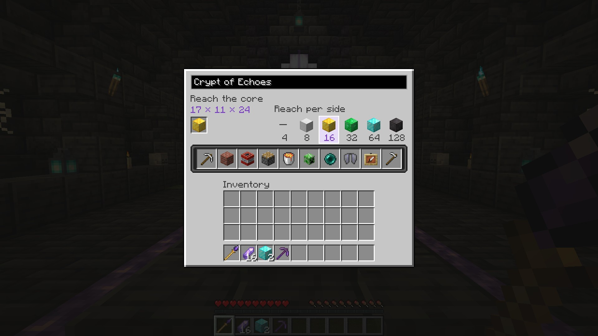
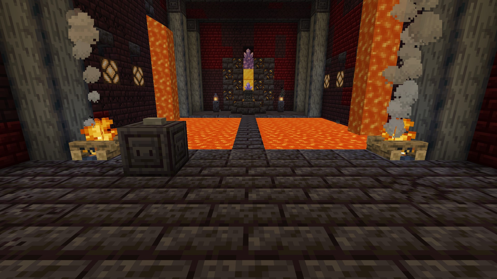
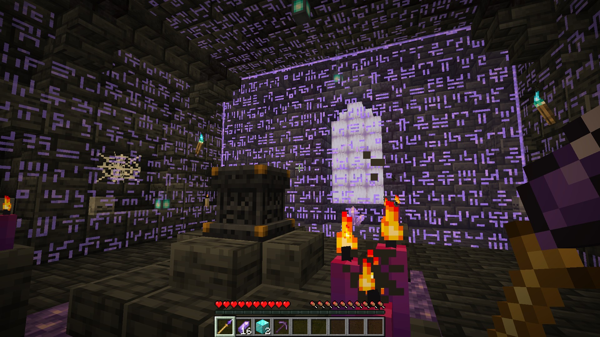

  

<h1 align="center">Zone Lock</h1>

  <b>Dungeons you have to beat before you can break them.</b> 
  Minecraft 26.3 · Fabric and NeoForge

  
  
  

  

Put an **Amethyst Core** in your dungeon and nothing around it can be broken or built until someone beats it. No
digging to the end, no pillaring over walls, no ender pearls past the puzzle: players have to actually play through it.

- Craftable in survival, works in multiplayer.
- Puzzles are built with vanilla blocks and redstone: the mod only stops them from being skipped.
- No chat spam: everything it tells you happens in the world.

## How it works

1. **Place a core.** Right-click it to name it and choose its rules.
2. **Shape its zone** with the **Resonance Wand**: click a wall to push it out, sneak + click to pull it in.
3. **Seal it** by placing an amethyst shard on top. The zone locks as soon as everyone has left it, so you never
   lock yourself in.
4. **Beat it.** Put out every seal inside, then switch the core off. The crystal shatters and the zone is free.

An armed core is a challenge for everyone, including whoever armed it.

  
   The core's screen: its name, its rules and the focus that sets its size.

## Seals and puzzles

| Block | What it does |
|---|---|
| **Amethyst Core** | Put out its seals, then switch it off. Right-click a locked core to see where the seals left are. |
| **Redstone Core** | Put out its seals, then power it. The end of any redstone puzzle. |
| **Amethyst Seal** | Goes out when touched. Hide it at the top of a parkour or the end of a maze. |
| **Redstone Seal** | Goes out with a redstone signal. |
| **Resonance Wand** | Shapes a zone, and shows the walls of every zone while you hold it. |

Seals and cores give a redstone signal when they open. Wire a door to a seal and it opens when that seal is put out:
one room leads to the next.

  
   No block bridges the lava: only the button raises the path.

## What a locked zone stops

- Breaking and placing blocks, buckets and boats (doors, buttons, levers and chests still work)
- Explosions, pistons, fluids and fire crossing the border
- Mob griefing, ender pearls, chorus fruit, elytra and riptide
- Breaking paintings, item frames and armor stands

Each rule can be turned off per core. Creative players bypass everything.

## In the game

- Hold the wand to see the walls of every zone. Without it, a wall shows up only when you walk close to it.
- A block that can't be broken ripples where you hit it.
- Inside a zone, a card in the corner shows its name and the seals left.

  

## Zone size

A core reaches 4 blocks per side. Put a focus block in its screen to grow it: iron or copper 8, gold or lapis 16,
emerald or amethyst 32, diamond 64, netherite 128.

  

## The Amethyst Tower

A rare tower in dark forests, pale gardens and old-growth taigas, with a library puzzle, a parkour shaft and its core
at the top. It comes in a built-in data pack you can turn off when creating a world.

## For map makers

In creative you can edit any core, and **Map lock** keeps everyone else from touching it. Operators have
`/zonelock list | here | lock | unlock`, and block tags let players break or place chosen blocks inside zones.

## Download

[Modrinth](https://modrinth.com/mod/zonelock) · [CurseForge](https://www.curseforge.com/minecraft/mc-mods/zonelock)

Install it on the server and on every client. Fabric also needs [Fabric API](https://modrinth.com/mod/fabric-api)
([Mod Menu](https://modrinth.com/mod/modmenu) is optional, for the settings).

[Changelog](CHANGELOG.md) · [Report a bug](https://github.com/CarlesRojas/zonelock/issues) · MIT license · Made by
Team Pinya
