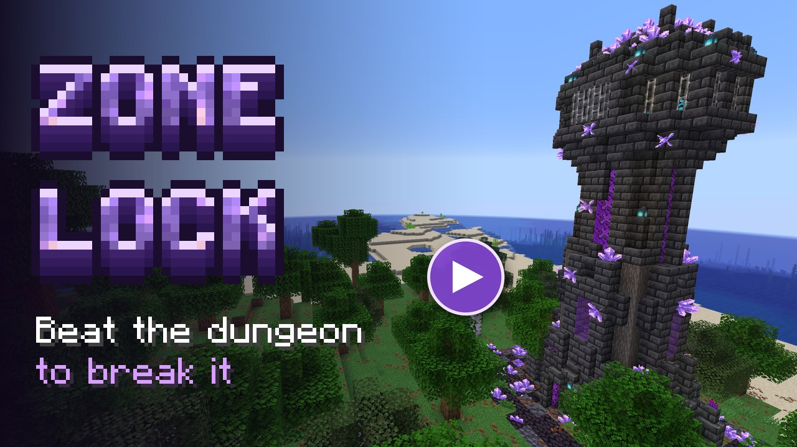

  

<h1 align="center">Zone Lock</h1>

  <b>Dungeons you have to beat before you can break them.</b> 
  Minecraft 26.3 · Fabric and NeoForge

  
  
  

  

Put an **Amethyst Core** in your dungeon and nothing around it can be broken or built until someone beats it. No
digging to the end, no pillaring over walls, no ender pearls past the puzzle: players have to actually play through it.

## How it works

1. **Place a core** and shape its zone with the **Resonance Wand**.
2. **Seal it** with an amethyst shard. The zone locks once everyone has left it.
3. **Beat it**: put out every seal inside, then switch the core off. The zone is free again.

  

- **Amethyst Seal**: goes out when you touch it. Hide it at the end of a parkour or a maze.
- **Redstone Seal**: goes out with a redstone signal. Any redstone puzzle works.
- Seals and cores give a redstone signal when they open, so a seal can open the door to the next room.

  
   Hold the wand to see every locked zone around you.

## Good to know

- Everything is craftable in survival and works in multiplayer.
- Doors, buttons, levers and chests still work inside a zone. Creative players can edit anything.
- Find the **Amethyst Tower** in dark forests and old-growth taigas: a ready-made dungeon with a core at the top.
- Install it on the server and on every client. On Fabric you also need
  [Fabric API](https://modrinth.com/mod/fabric-api).

[Changelog](CHANGELOG.md) · [Report a bug](https://github.com/CarlesRojas/zonelock/issues) · MIT license · Made by
Team Pinya
