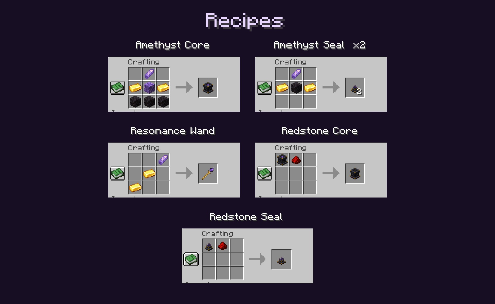

<p align="center">
  
</p>

<h1 align="center">Zone Lock</h1>

<p align="center">
  <b>Dungeons you have to beat before you can break them.</b><br>
  A Minecraft mod for Fabric and NeoForge (26.3)
</p>

<p align="center">
  <a href="https://modrinth.com/mod/zonelock"></a>
  <a href="https://www.curseforge.com/minecraft/mc-mods/zonelock"></a>
  <a href="https://youtu.be/W94lSa-9igw"></a>
  <br>
  
  
  <a href="LICENSE"></a>
</p>

<p align="center">
  <a href="https://youtu.be/W94lSa-9igw"></a>
</p>

Seal an area with an **Amethyst Core** and nothing inside it can be broken, built or skipped until the challenge
is beaten: no digging straight to the end, no towering over the walls, no ender pearls past the puzzle. Build a
dungeon around a core and players have to actually play through it. Reach the core, switch it off, and the place
is yours. Or find the **Amethyst Tower** in the wild.

- Everything is craftable in survival, and works in multiplayer.
- Vanilla-friendly: puzzles are built with vanilla blocks and redstone; the mod only keeps them from being skipped.
- No chat spam: everything the mod tells you happens in the world.

## Contents

- [Download](#download)
- [How it works](#how-it-works)
- [Seals and puzzles](#seals-and-puzzles)
- [What a sealed zone stops](#what-a-sealed-zone-stops)
- [Feedback in the game](#feedback-in-the-game)
- [Survival progression](#survival-progression)
- [The Amethyst Tower](#the-amethyst-tower)
- [For map makers](#for-map-makers)
- [Building from source](#building-from-source)

## Download

| | |
|---|---|
| **Modrinth** | [modrinth.com/mod/zonelock](https://modrinth.com/mod/zonelock) |
| **CurseForge** | [curseforge.com/minecraft/mc-mods/zonelock](https://www.curseforge.com/minecraft/mc-mods/zonelock) |
| **Trailer** | [youtu.be/W94lSa-9igw](https://youtu.be/W94lSa-9igw) |
| **YouTube channel** | [@zonelockmod](https://www.youtube.com/@zonelockmod) |

Requirements:

- **Fabric**: Fabric Loader and [Fabric API](https://modrinth.com/mod/fabric-api).
  [Mod Menu](https://modrinth.com/mod/modmenu) is optional, for the settings screen.
- **NeoForge**: nothing else.
- Install it on the server **and** on every client.

## How it works

1. **Place a core.** Craft an Amethyst Core and place it in your dungeon. Right-click it to open its screen: its
   name, its rules and its focus. Cores belong to nobody: anyone can set up a switched-off core.
2. **Shape its zone** with the **Resonance Wand**: point at a wall of the zone; each click pushes it a block away,
   sneak + click pulls it back (from inside that grows the zone, from outside it shrinks it). Zones never overlap:
   a wall stops against another zone, and a core can't be placed inside one.
3. **Seal it** by placing an **amethyst shard** on top. The crystal rises and the zone locks **as soon as everyone
   has left it** (and nobody near it holds a wand), so you can never shut yourself in while setting up your own
   dungeon. Until then nothing changes: you can still edit it, the seals don't react, and every door wired to them
   stays open. Sneak + use on the core takes the shard back.
4. **Beat it.** Whoever wants in has to put out every seal of the zone and then switch the core off. The crystal
   shatters and the zone is free again.

<p align="center">
  
  <br><sub>The core's screen: the zone's name, what it takes to beat it, and the focus that sets its size.</sub>
</p>

**An armed core is a challenge for everyone, whoever armed it included**: nothing about it or its seals can be
changed until it is beaten (creative map makers excepted). A beaten core keeps its configuration and is anyone's to
set up again; placing a shard on it restarts the challenge, and every seal burns again.

A bed or respawn anchor inside a sealed zone doesn't bring you back there: you respawn at the world spawn, so dying
is always a way out of a dungeon and never a way back into a room you were stuck in.

## Seals and puzzles

| Block | What it does |
|---|---|
| **Amethyst Core** | Put out every seal inside its zone, then switch the core off. With no seals, reaching it is enough. Right-clicking a locked core sends a pulse of energy along the corridors to each seal that still burns. |
| **Redstone Core** | Put out its seals (if any), then power the core. The output of any redstone puzzle you can build. |
| **Amethyst Seal** | Goes out when touched. Hide it at the top of a parkour, behind a maze, at the end of a corridor. |
| **Redstone Seal** | Goes out with a redstone signal. |
| **Resonance Wand** | Shapes the zone of a switched-off core, and shows the walls of every zone while you hold it. |

**Seals and cores give a redstone signal** (strength 15, like a redstone block) whenever they aren't holding anything
shut: a seal once it is put out, a core once it is switched off, and both while the zone isn't armed. Wire a door to a
seal and it stands open while you build, shuts when the core is armed, and opens when a challenger puts that seal out:
one room leads to the next. Wire the treasure room to the core and it opens when the dungeon is beaten.

<p align="center">
  
  <br><sub>A sanctum: the core in the middle, an Amethyst Seal on the left and a Redstone Seal on the right.</sub>
</p>

<p align="center">
  
  <br><sub>A puzzle that can't be skipped: no block bridges the lava, only the button raises the path.</sub>
</p>

## What a sealed zone stops

Every rule can be turned off per core.

- Breaking and placing blocks, buckets, boats (doors, buttons, levers and chests always work)
- Explosions, pistons pushing across the border, fluids flowing in or out, fire spreading
- Mob griefing: endermen, withers, ravagers, trampled crops
- Ender pearls and chorus fruit landing inside, elytra gliding and riptide launches inside
- Breaking paintings, item frames and armor stands
- Tools changing blocks: stripping, tilling, bone meal, flint and steel

Creative players bypass everything, so builders can keep working.

## Feedback in the game

- The border is invisible until you hold a **Resonance Wand**: then its walls show as small amethyst runes, sliding
  along while the zone is armed, still and dimmer while it is off (the wall the wand points at lights up).
- Without the wand, coming close to a sealed wall shows a patch of it around you, fading out. It can be turned off
  in the mod's settings (Mod Menu on Fabric, the mods list on NeoForge).
- A block that refuses to change **ripples** where you hit it, over its real shape: the solid surface of blocks, the
  model of things you walk through (wheat, flowers, rails, torches), the plate of an item frame. No text pops up.
- Inside a zone, its quest card shows in the top-left corner: the zone's name and what's left
  ("Put out the seals 2/4").
- The core's floating crystal spins while armed.

<p align="center">
  
  <br><sub>The Resonance Wand shows the walls of every zone around you.</sub>
</p>

## Survival progression

A core reaches 4 blocks per side. Put a **focus block** in its screen (like paying a beacon) to grow it:

| Focus | Blocks per side |
|---|---|
| none | 4 |
| iron or copper | 8 |
| gold or lapis | 16 |
| emerald or amethyst | 32 |
| diamond | 64 |
| netherite | 128 |

That is the same for everyone, creative included. A dungeon's core comes with the zone its dungeon needs, but once
beaten it is an ordinary core: armed again, the zone shrinks to what its focus allows.

<p align="center">
  
  <br><sub>Recipes for the cores, the seals and the Resonance Wand.</sub>
</p>

## The Amethyst Tower

A rare, hand-built tower found in dark forests, pale gardens and old-growth taigas, with a library puzzle and a
parkour shaft. Its core waits at the top, and the amethyst eats the ground around it.

It comes in a built-in data pack, **Zone Lock: Dungeons**, enabled by default: turn it off under
**Create World > Data Packs** for worlds without it.

## For map makers

- In creative you can edit any core. **Map lock** stops everyone but creative operators from touching it: while it
  is armed players only get the challenge, and once it is off it doesn't react to them at all.
- `/zonelock list | here | lock | unlock` for operators.
- Block tags `#zonelock:breakable_in_zones` and `#zonelock:placeable_in_zones` mark blocks that players may break or
  place inside zones (cobwebs to cut, blocks for a puzzle...). `#zonelock:focus/tier_1..5` set the focus blocks.
- Core block entity data, for structure templates:

  ```
  {config:{name:"...",extents:{up:8,down:2,north:8,south:8,east:8,west:8},rules:1023,seals:1b,redstone:0b,config_locked:1b},armed:1b}
  ```

## Building from source

Requires **JDK 25** (Gradle itself must run on it).

```
./gradlew build                      # both jars in fabric/build/libs and neoforge/build/libs
./gradlew :fabric:runClient          # or :neoforge:runClient
./gradlew :neoforge:runGameTestServer :fabric:runServerSmokeTest   # boots servers, checks every mixin applies
./gradlew :fabric:runClientGameTest  # plays scripted scenarios in the real client and takes screenshots
```

Project layout ([MultiLoader template](https://github.com/jaredlll08/MultiLoader-Template)): almost everything lives
in `common/`, compiled against vanilla, with the protection done through Mixins shared by both loaders. `fabric/` and
`neoforge/` only hold the loader glue (registration, events, networking, renderers).

| Folder | What's in it |
|---|---|
| `common/` | Blocks, zones, rules, rendering and the Mixins |
| `fabric/`, `neoforge/` | Loader glue; `fabric/src/gametest` holds the client game tests and the trailer recorder |
| `art/structures/` | The Amethyst Tower generator |
| `art/trailer/` | The trailer's sets (`sets.py`) and its composer (`compose.py`) |
| `art/logo/`, `art/publish/` | Logo, banner, store texts and screenshots |

Releases: push a `v*` tag; GitHub Actions builds and publishes to Modrinth, CurseForge and GitHub Releases (set
`modrinth_id` / `curseforge_id` in `gradle.properties` and the `MODRINTH_TOKEN` / `CURSEFORGE_TOKEN` secrets).

Changes between versions are in [CHANGELOG.md](CHANGELOG.md). Bugs and ideas: [GitHub Issues](https://github.com/CarlesRojas/zonelock/issues).

## License

[MIT](LICENSE). Made by Team Pinya.
