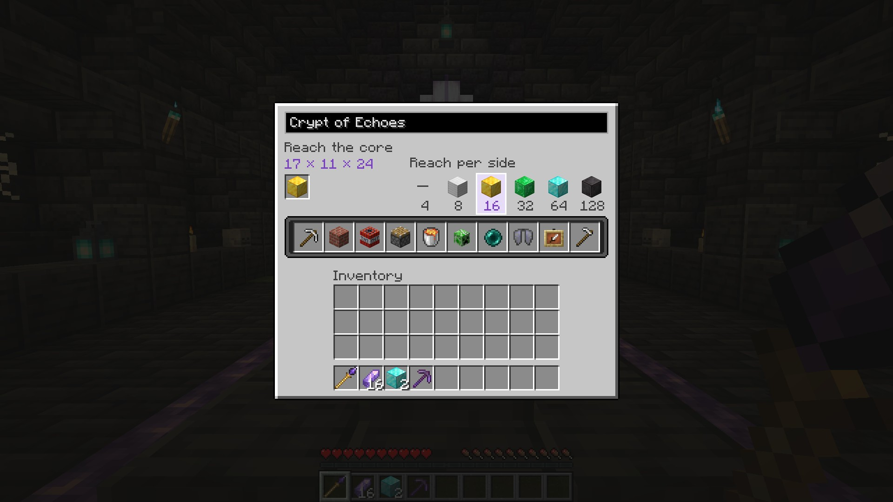
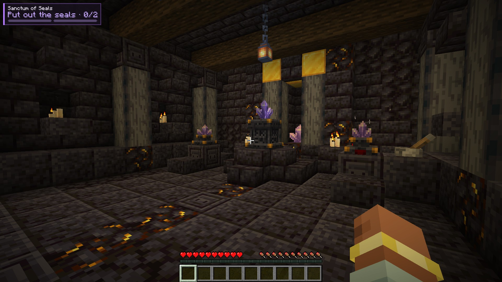
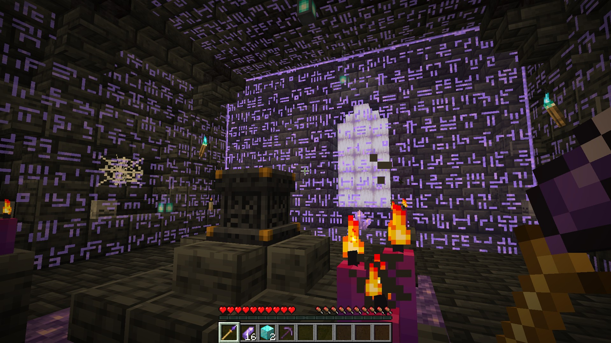
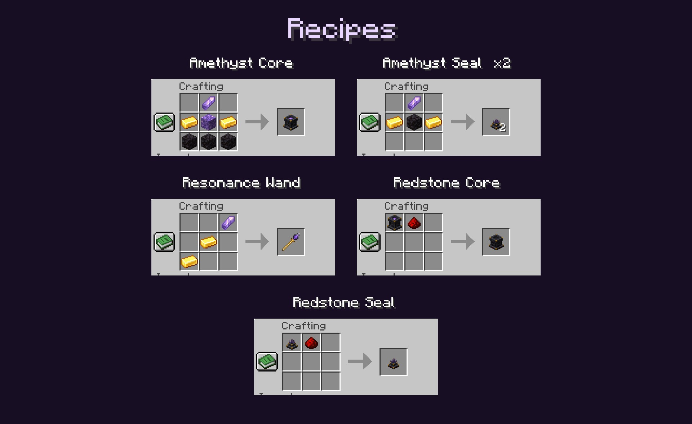
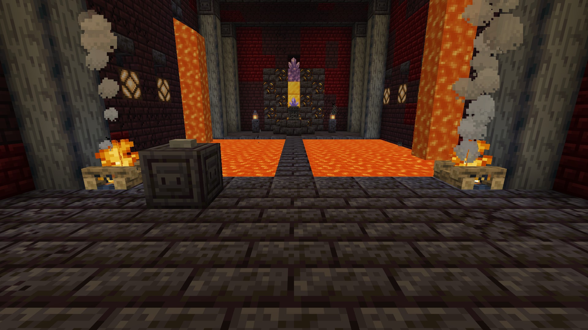

# Zone Lock

**Dungeons you have to beat before you can break them.**

Seal an area with an **Amethyst Core** and nothing inside it can be broken, built or skipped until the challenge is beaten: no digging straight to the end, no towering over the walls, no ender pearls past the puzzle. Reach the core, switch it off, and the place is yours.

{{TRAILER}}

**Fabric and NeoForge · Minecraft 26.3 · Everything craftable in survival · Works in multiplayer**

---

## How it works

1. **Place a core.** Right-click it to name it and choose its rules. Cores belong to nobody: anyone can set up a switched-off core.
2. **Shape its zone** with the **Resonance Wand**: point at a wall of the zone; each click moves it a block away, sneak + click pulls it back. Zones never overlap.
3. **Seal it** by placing an **amethyst shard** on top. The zone locks as soon as everyone has left it, so you can never shut yourself in while setting up your own dungeon.
4. **Beat it.** Whoever wants in has to put out every **seal** of the zone and then switch the core off. Then the crystal shatters and the zone is free again.

## Seals and puzzles

- **Amethyst Seal**: goes out when touched. Hide it at the top of a parkour, behind a maze, at the end of a corridor.
- **Redstone Seal**: goes out with a redstone signal. The output of any redstone puzzle you can build.
- **Redstone Core**: put out its seals, then power the core.
- A locked core shows the way: right-click it and a pulse of energy travels through the corridors to every seal still burning.
- **Seals and cores give a redstone signal** while they aren't holding anything shut. Wire a door to a seal and it opens when that seal goes out: one room leads to the next. Wire the treasure room to the core and it opens when the dungeon is beaten.

## What a sealed zone stops

Every rule can be turned off per core.

- Breaking and placing blocks, buckets, boats (doors, buttons, levers and chests always work)
- Explosions, pistons pushing across the border, fluids flowing in or out, fire spreading
- Mob griefing: endermen, withers, ravagers, trampled crops
- Ender pearls and chorus fruit landing inside, elytra and riptide inside
- Breaking paintings, item frames and armor stands
- Tools changing blocks: stripping, tilling, bone meal, flint and steel

Creative players bypass everything, so map makers keep building.

## Feedback that stays in the game

- The border is invisible until you hold the **Resonance Wand**: then its walls show as sliding amethyst runes.
- Come close to a sealed wall without the wand and a patch of it fades in around you (can be turned off).
- A block that refuses to change **ripples** where you hit it, over its real shape. No chat spam.
- Inside a zone, a small card in the corner says what's left to do ("Put out the seals 1/2").

## Survival progression

A core reaches 4 blocks per side. Put a **focus block** in its screen (like paying a beacon) to grow it: iron or copper 8 · gold or lapis 16 · emerald or amethyst 32 · diamond 64 · netherite 128 blocks per side.

## The Amethyst Tower

A rare, hand-built tower found in dark forests, pale gardens and old-growth taigas, with a library puzzle and a parkour shaft. Its core waits at the top. It comes in a built-in data pack, enabled by default: turn it off under **Create World → Data Packs** if you don't want it.

## For map makers

- In creative you can edit any core. **Map lock** keeps everyone but creative operators away from a core: players only get the challenge.
- `/zonelock list | here | lock | unlock` for operators.
- Block tags `#zonelock:breakable_in_zones` and `#zonelock:placeable_in_zones` mark blocks players may break or place inside zones (cobwebs to cut, blocks for a puzzle).
- Dying never sends you back into a locked room: beds and respawn anchors inside a sealed zone don't count.

## Requirements

- **Fabric**: Fabric Loader and [Fabric API](https://modrinth.com/mod/fabric-api). [Mod Menu](https://modrinth.com/mod/modmenu) optional, for the settings screen.
- **NeoForge**: nothing else.
- Needed on both the server and the clients.

Languages: English and Spanish.

Source code and issues: [GitHub](https://github.com/CarlesRojas/zonelock) · License: MIT
